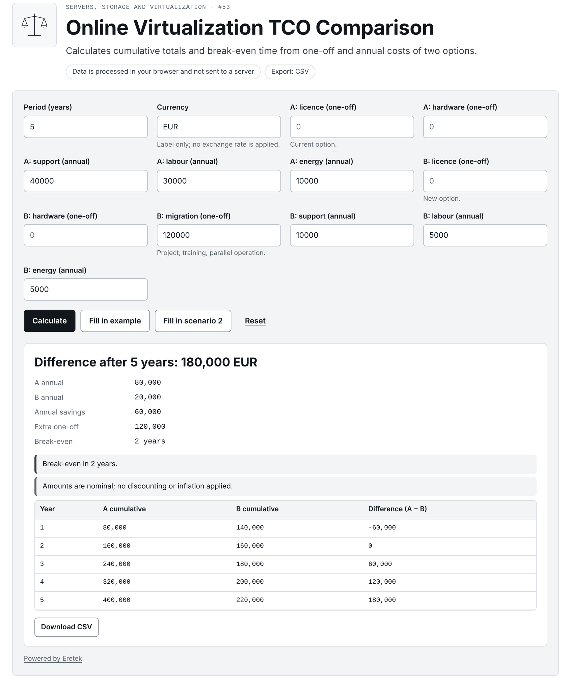

# Virtualization TCO Comparison

Compare licence, hardware, support, labour, energy and migration costs of current and new infrastructure year by year; break-even time and total difference.

## Try it live

- [Türkçe](https://sistem.eretek.com/araclar/sanallastirma-tco-karsilastirma)
- [English](https://sistem.eretek.com/en/tools/virtualization-tco-comparison)
- [Deutsch](https://sistem.eretek.com/de/werkzeuge/virtualisierung-tco-vergleich)



## What it does

Calculates cumulative totals and break-even time from one-off and annual costs of two options.

Looking only at the purchase price misleads server refresh, cloud migration or virtualization decisions: annual support, labour and energy can exceed the initial investment within a few years. The tool accumulates options A (current) and B (new) year by year and shows how many years the investment takes to pay back.

## Where it helps

Set the period to the economic life of the hardware (usually 5 years). Without annual savings, decide on grounds such as risk reduction or new capabilities.

## How to use it

1. Enter the period (years) and currency.
2. Enter one-off (licence, hardware, migration for B) and annual (support, labour, energy) costs for A and B; empty fields count as 0.
3. Press Calculate; download the yearly table as CSV.

### Fields

| Field | Description |
|---|---|
| Period (years) |  |
| Currency | Label only; no exchange rate is applied. |
| A: licence (one-off) | Current option. |
| A: hardware (one-off) |  |
| A: support (annual) |  |
| A: labour (annual) |  |
| A: energy (annual) |  |
| B: licence (one-off) | New option. |
| B: hardware (one-off) |  |
| B: migration (one-off) | Project, training, parallel operation. |
| B: support (annual) |  |
| B: labour (annual) |  |
| B: energy (annual) |  |

## Example input

Press **Fill in example** in the tool to load this input.

| Input | Value |
|---|---|
| Period (years) | `5` |
| Currency | `EUR` |
| A: support (annual) | `40000` |
| A: labour (annual) | `30000` |
| A: energy (annual) | `10000` |
| B: migration (one-off) | `120000` |
| B: support (annual) | `10000` |
| B: labour (annual) | `5000` |
| B: energy (annual) | `5000` |

**Expected result:** B's 120,000 migration cost pays back in 2 years with 60,000 annual savings; difference after 5 years 180,000 EUR.

## Method and assumptions

Cumulative(y) = one-off + annual × y. Break-even = (B one-off − A one-off) / (A annual − B annual). Amounts are nominal; no inflation, discounting or exchange rates.

## Limits and common mistakes

- Time value of money (NPV/IRR), tax, depreciation and residual value are not calculated.

## Run it locally

The tool is plain HTML, CSS and JavaScript with no build step and no dependencies.

```bash
git clone https://github.com/eretek/virtualization-tco-comparison.git
cd virtualization-tco-comparison
node scripts/serve.js        # or: python3 -m http.server 8080
```

Open <http://127.0.0.1:8080/>. Add `?lang=tr` or `?lang=de` for Turkish or German; without it the page follows the browser language and falls back to English. You can also open `index.html` directly from disk.

Run the tests (Node.js 18 or later):

```bash
node test/run.js    # or: npm test
```

The tests run the tool's own fixtures and the worked examples in all three languages without a browser.

## How it works

All processing happens in your browser. The tool makes no network requests, uses no cookies or browser storage, and does not upload files you select.

No server-side component is needed. The version on the Eretek website renders the same page through a private WordPress plugin; that plugin only produces the page markup and is not part of this repository.

| Path | Purpose |
|---|---|
| `index.html` | Page shell |
| `src/app.js` | Builds the page in Turkish, English or German from `src/data.js` |
| `src/data.js` | Field definitions, examples and all texts in three languages |
| `src/core.js` | Shared runtime: validation, number formats, result rendering, CSV/ICS export |
| `src/tool.js` | The calculation or analysis for this tool |
| `docs/screenshot.png` | Screenshot used in this README |
| `src/tools.css`, `src/page.css` | Styles |
| `test/run.js`, `test/cases.json` | Headless tests |

## License and attribution

This tool is released under the [Eretek Website Attribution License](LICENSE). You may use, modify and redistribute it, including commercially. If you make it available on a website or web application, show a visible, clickable credit linking to https://eretek.com/ on every page where the tool is available, for example:

```html
<a href="https://eretek.com/">Powered by Eretek</a>
```

You may add `rel="nofollow"` to the link. Keep the copyright notice and license text in copies and redistributions.
